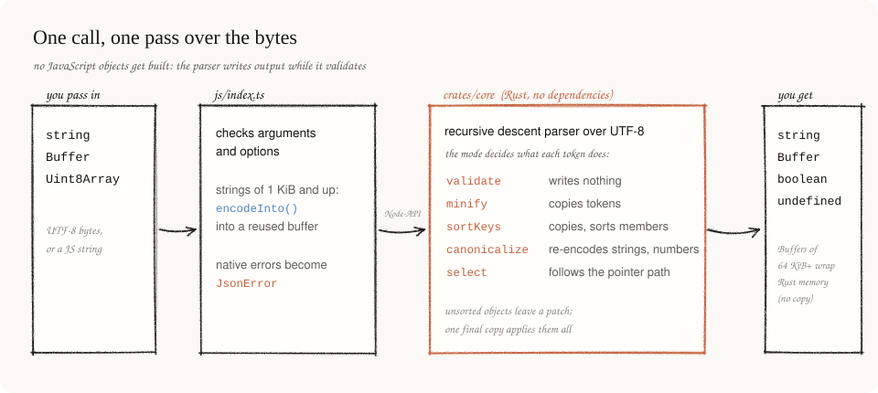
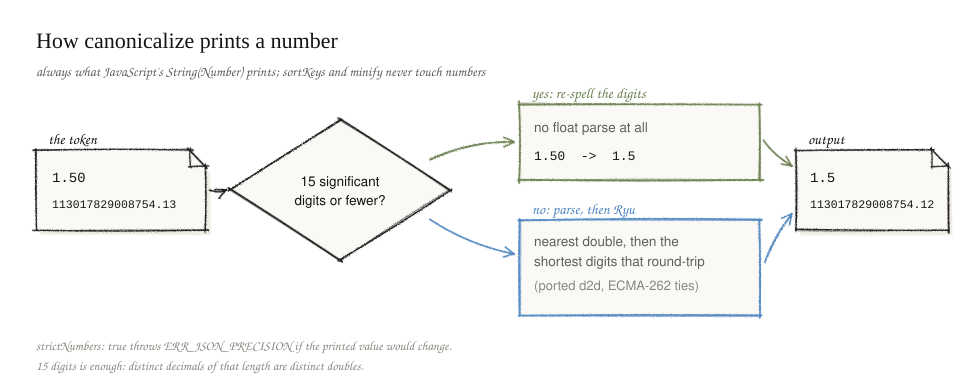

# Architecture

json-canonical reads JSON text once and writes the result during that one pass.
It never builds a token tree or JavaScript objects, and that is where the speed
comes from. This page follows a call from JavaScript into Rust and back.

## Layout

| Path | Role |
|---|---|
| `crates/core` | The engine. Plain Rust, no dependencies, `unsafe` forbidden by the crate. |
| `crates/node` | Node-API binding built with napi-rs v3. Denies `unsafe` in its own code and allows only what the napi macros generate. |
| `js/index.ts` | Public API. Validates arguments, chooses how strings cross into Rust, turns native error strings into `JsonError`. |
| `js/cli.ts` | The `jcanon` command, a thin layer over the public API. |

## One pass, output written while reading

`parser.rs` is a recursive descent parser over UTF-8 bytes. It validates RFC 8259
and writes the requested output in the same pass, with no separate validation
step. The mode decides what happens to each token:

| Mode | What it does with each token |
|---|---|
| validate | writes nothing |
| minify | copies the token |
| sort | copies the token, reorders object members |
| canonical | re-encodes strings and numbers, reorders object members |
| select | tracks only values on the pointer path |

### Sorting without moving bytes

Sorting allocates no node per value. Each object member is written to the output
as it is parsed, and its byte span goes on a shared member stack. When the object
closes, the parser checks whether the members are already in order. For
machine-written JSON that is already sorted, that check is the whole cost.

When they are out of order, the parser sorts the spans and records a patch: the
body range plus the sorted spans. No bytes move yet. After parsing, one pass copies
the output with every patch applied, so each byte is copied once however deep the
unsorted objects nest. Moving bytes at each level instead would cost
O(size × depth). Duplicate keys show up as equal neighbours after sorting.

### Key order

Keys compare by UTF-16 code units, which is both RFC 8785 order and JavaScript's
default sort. `text::cmp_utf16` compares UTF-8 bytes directly and corrects the one
case where byte order and UTF-16 order disagree: a supplementary character (above
U+FFFF) against one in U+E000..U+FFFF. That is why `😀` (U+1F600) sorts before U+FFFF.

Keys written with escapes are decoded once into a shared UTF-16 arena. Lone
surrogate escapes are legal RFC 8259 and keep their UTF-16 position in sort mode.

### Scanning strings

String scanning skips eight bytes at a time with a SWAR test for `"`, `\` and
control bytes, written with safe `u64::from_le_bytes`.

## Numbers

Sort and minify never interpret numbers, so they never lose precision. Canonical
mode follows ECMA-262 `Number::toString` (`number.rs`) in one of two ways:

1. **15 significant digits or fewer**, in the normal double range: the token is
   already its own shortest representation, because distinct decimals of that
   length map to distinct doubles. The digits are re-spelled directly, with no
   float parse or format. Most real data takes this path.
2. **Longer tokens** are parsed to the nearest double, and a port of Ryu's `d2d`
   (`crates/core/src/ryu.rs`) produces the digits. Ryu returns the shortest digits
   that round-trip, closest to the exact value and even on a tie, which is the
   ECMA-262 rule. At a power of two the rounding interval is lopsided; Ryu accounts
   for it, so no second pass is needed.

`strictNumbers` compares the token's significant digits and exponent with the
canonical digits and rejects any difference. It catches numbers whose printed
value would change, not numbers that are inexact in binary, so `0.1` passes.

## Selection

`select` runs the validating mode with a path. Only values on the path are
tracked. Matching a key at one level clears any earlier match below it, which
gives `JSON.parse` last-duplicate-wins behaviour in a single pass. The result is
a slice of the input, copied once into the returned string.

## Crossing the boundary

Measurements decided how text moves between JavaScript and Rust:

- Node-API string conversion makes three passes: measure the UTF-8 length,
  zero-fill a buffer, transcode. For strings of 1 KiB and up, the wrapper encodes
  with `TextEncoder.encodeInto` into a reused buffer (at most 16 MiB retained) and
  passes it as a zero-copy `Buffer`. Smaller strings use the direct path, where it
  is faster.
- Both paths would turn a lone surrogate character into U+FFFD. Small strings are
  checked with `isWellFormed`. Large ones are checked only when the encoded bytes
  contain U+FFFD, found with a byte search an order of magnitude faster.
- Buffer outputs under 64 KiB are copied into a normal Buffer. Larger ones become
  an external Buffer over the Rust allocation, which avoids the copy but costs
  several microseconds to create and finalize.
- Async variants copy the input before queueing, because JavaScript may change a
  Buffer while the worker reads it.

## Limits

Depth defaults to 128 and is capped at 1024. That keeps the recursion well under a
1 MiB thread stack, the size of libuv workers on Windows. `maxBytes` bounds the
input and, separately, the output. Only canonical numbers can make the output
longer than the input, so the output check runs after each re-spelled number.
