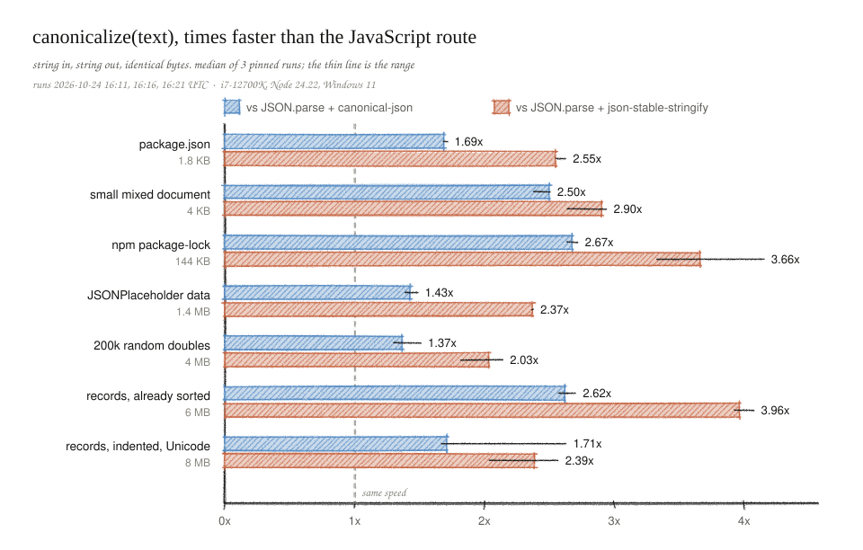
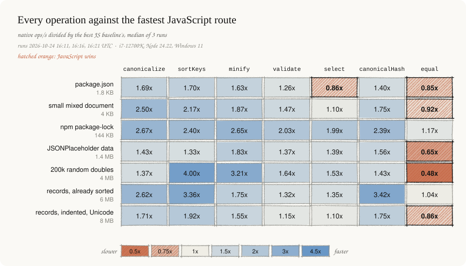

# Performance

json-canonical beats the fastest JavaScript route for every operation except
`equal` on most inputs and `select` on tiny documents. The charts below are drawn
from runs `2026-10-24T16-11-41-552Z`, `16-16-26-099Z` and `16-21-13-048Z` by
`scripts/gen-docs-graphics.py`; the sections after them hold the method, every
table and the earlier runs.

The grid divides native ops/s by the fastest JavaScript baseline in the same run,
then takes the median of the three runs. Those runs repeated every cell, so the
`equal` and `canonicalHash` columns differ slightly from the 15:17 to 15:25 runs
quoted under [equal and canonicalHash](#equal-and-canonicalhash): `equal` on
package.json is 0.85x here and 0.79x there, inside the noise that section
describes.

## Method

`pnpm bench` (`benches/run.cjs`) times the public API end to end, including
argument checks, the Node-API crossing and creating the returned string or
Buffer. For each fixture and operation it first runs every implementation once
and checks the output: `exact` means byte-identical to the reference, `same
value` means equal after `JSON.parse` (used where formats legitimately differ,
such as a baseline that normalizes numbers). Each cell then gets 500 ms of
warmup and nine samples of at least 100 ms; the table shows the median and the
median absolute deviation. Cells run in shuffled order. Raw samples are written
to `benches/results/<timestamp>.json` and never overwritten.

Baselines are what a Node developer would write without this package:
`JSON.parse` followed by `canonicalizeValue` (the same algorithm as the
`canonicalize` npm package), `canonical-json` 0.4.0, `json-stable-stringify`
1.3.0, `safe-stable-stringify`, `fast-json-stable-stringify`
at commit 49e230d, `JSON.stringify`, plain property access, `util.isDeepStrictEqual` on two parsed documents for `equal`,
and `crypto.createHash('sha256')` over a JavaScript serializer for `canonicalHash`. "previous native"
is the 0.1 addon built from commit 39ef120, kept at `target/baseline/old.node`.

Fixtures: four files recorded with source URLs, commits and hashes in
`benches/data/manifest.json` (TypeScript's package.json and package-lock.json,
the fast-json-stable-stringify benchmark fixture, JSONPlaceholder data), plus
three seeded synthetic documents: 40,000 records indented with Unicode text,
the same records already sorted and minified, and 200,000 random doubles.

## Environment

Windows 11 Pro x64, Intel i7-12700K, Node 24.22.1 (V8 13.6.233.17), rustc
1.98.1, release profile with fat LTO and one codegen unit. Each run was pinned to
the performance cores (affinity 0xFFFF) at high priority. An unpinned run in the
background (`2026-10-24T04-41-06-112Z.json`) had baselines 2.5 times slower than
an identical earlier run and is kept only as a record of that failure. Even
pinned, single runs varied by up to about 30% on small fixtures, so the table
reports three runs. Linux and macOS have not been measured.

## Results

These runs predate the `canonical-json` and `json-stable-stringify` baselines.
`canonical-json` turned out faster than every baseline used here, so the
canonicalize column overstates the lead; the section on those two packages below
has the current figures.

Code with the Ryu number formatter (decisions D10), runs `2026-10-24T14-38-40-349Z`, `14-41-08-351Z` and `14-43-36-189Z`.
Each cell is the median ratio over the three runs against the fastest JavaScript
baseline for that operation, with the range in parentheses. Inputs and outputs
are strings unless the column says Buffer. The last column is the 0.1 addon
against the same JavaScript baseline, for comparison with the sortKeys column.
All 294 cells produced the checked output; 14 had a within-run MAD above 5%.

| fixture | bytes | canonicalize | sortKeys | minify | validate | select | canonicalize, Buffer in/out | sortKeys, 0.1 addon |
|---|---:|---:|---:|---:|---:|---:|---:|---:|
| jsonplaceholder-data | 1378184 | 2.32x (2.19-2.52) | 1.38x (1.37-1.47) | 1.70x (1.57-1.77) | 1.37x (1.36-1.47) | 1.41x (1.41-1.50) | 2.72x (2.54-2.96) | 1.36x (1.04-1.38) |
| synthetic-already-sorted | 5904178 | 4.19x (4.12-4.23) | 3.43x (3.32-3.63) | 1.69x (1.69-1.86) | 1.35x (1.31-1.36) | 1.36x (1.32-1.43) | 6.63x (6.62-6.64) | 2.00x (1.72-2.12) |
| synthetic-floats | 4052927 | 1.60x (1.60-1.61) | 4.20x (4.11-4.58) | 3.35x (3.29-3.50) | 1.56x (1.56-1.64) | 1.53x (1.52-1.59) | 1.74x (1.70-1.76) | 2.17x (2.03-2.27) |
| synthetic-records-8mb | 8184179 | 2.57x (2.46-2.67) | 1.99x (1.95-2.00) | 1.54x (1.50-1.54) | 1.12x (1.09-1.15) | 1.11x (1.09-1.13) | 3.30x (3.21-3.54) | 1.66x (1.31-1.84) |
| typescript-package | 1838 | 2.68x (2.66-2.74) | 1.76x (1.75-1.79) | 1.62x (1.57-1.65) | 1.19x (1.08-1.23) | 0.87x (0.85-0.93) | 2.44x (2.41-2.54) | 1.64x (1.59-1.74) |
| typescript-package-lock | 143844 | 3.65x (3.59-3.87) | 2.41x (2.31-2.45) | 2.48x (2.44-2.52) | 2.00x (1.92-2.09) | 1.95x (1.91-1.96) | 3.63x (3.48-3.69) | 1.62x (1.59-1.70) |
| upstream-test | 3965 | 2.90x (2.89-2.94) | 2.06x (2.03-2.08) | 1.86x (1.84-1.97) | 1.49x (1.42-1.53) | 1.18x (1.18-1.25) | 2.79x (2.78-2.80) | 1.80x (1.77-1.82) |

Every per-cell median, MAD and raw sample is in the JSON files.

## What the numbers say

The engine wins most where JavaScript has to build objects it then throws away.
Canonicalization runs 1.6 to 4.2 times faster than parse-and-serialize from a
string, and up to 6.6 times faster with Buffer input and output. Sorting with
preserved tokens runs 1.4 to 4.2 times faster. It beats the 0.1 addon on six
fixtures and ties it on JSONPlaceholder.

It loses in one place: `select` on a 1.8 KB document is 0.87x. At that size the
call overhead is most of the cost and V8's `JSON.parse` is very fast. Validating
the 8 MB indented string is only 1.12x, because UTF-16 to UTF-8 transcoding takes
about as long as the parse; as a Buffer the same document validates in about half
the time `JSON.parse` takes on the string.

## Number formatter, before and after

Runs `05-03-37-786Z` (before) and `14-41-08-351Z` (after), 200,000 random
doubles in 4 MB. Before, each 16 or 17 digit number went through Rust's `{:e}`
and then a second correctly rounded format. The Ryu port produces the right
digits in one pass.

| Cell | Before ops/s | After ops/s |
|---|---:|---:|
| canonicalize, string | 18.8 | 41.2 |
| canonicalize, Buffer in/out | 18.7 | 43.7 |
| JS baseline, same run | 23.4 | 25.7 |

Medians over the three runs on each side moved from 0.80x to 1.60x (string) and
from 0.80x to 1.74x (Buffer). Cells that never format a double also moved
between the two sets of runs, the largest being JSONPlaceholder `select` (1.83x to
1.41x) and `sortKeys` (1.59x to 1.38x). The new values sit inside or just under
the earlier runs' ranges (1.46-1.99 and 1.28-1.69), which points to machine
variance; neither path formats doubles.

## equal and canonicalHash

Runs `2026-10-24T15-17-29-365Z`, `15-21-22-748Z` and `15-25-14-173Z`, same
harness and pinning. These runs repeat every cell above as well; this section
only reports the two new operations. The second document for `equal` is the
same value with keys in reverse order and a two-space indent, so the comparison
returns true and has to sort every object. All 441 cells produced the checked
output; 52 had a within-run MAD above 5%, more than the runs above, so read
differences under about 10% as noise.

| fixture | equal | canonicalHash | canonicalHash, Buffer in |
|---|---:|---:|---:|
| jsonplaceholder-data | 0.63x (0.62-0.68) | 1.62x (1.60-1.68) | 1.67x (1.66-1.85) |
| synthetic-already-sorted | 0.93x (0.92-1.03) | 4.60x (4.37-4.81) | 5.33x (5.31-5.86) |
| synthetic-floats | 0.49x (0.49-0.49) | 1.63x (1.59-1.75) | 1.64x (1.59-1.69) |
| synthetic-records-8mb | 0.86x (0.74-0.89) | 2.54x (2.32-2.58) | 2.79x (2.70-3.00) |
| typescript-package | 0.79x (0.73-0.94) | 1.51x (1.40-1.70) | 1.55x (1.54-1.93) |
| typescript-package-lock | 1.22x (1.20-1.42) | 2.30x (2.11-2.32) | 2.38x (2.34-2.40) |
| upstream-test | 0.95x (0.87-0.99) | 1.72x (1.48-1.85) | 1.74x (1.59-1.80) |

`canonicalHash` wins on every fixture. The fastest JavaScript baseline was
always `safe-stable-stringify` plus SHA-256, which gives the same hash on these
fixtures because their strings and numbers already print the RFC 8785 way.
`canonicalizeValue` plus SHA-256 was slower still.

`equal` loses on six of seven fixtures. It canonicalizes both documents in full
and compares the bytes, while `isDeepStrictEqual` walks two trees that
`JSON.parse` built very quickly, so on floats the engine pays for formatting
400,000 doubles that the JavaScript side never prints. The two also answer
slightly different questions: `isDeepStrictEqual` treats `0` and `-0` as
different and accepts duplicate keys, while `equal` follows RFC 8785, so `[-0]`
equals `[0]` and duplicate keys throw. Against `canonicalizeValue` on both
sides, the comparison with the same semantics, `equal` is 1.7 to 4.2 times faster
in the median (1.7x on floats).

## canonical-json and json-stable-stringify

Runs `2026-10-24T16-11-41-552Z`, `16-16-26-099Z` and `16-21-13-048Z`, same harness
and pinning. These are the two packages people are most likely to use today:
`canonical-json` is a JavaScript RFC 8785 serializer, and `json-stable-stringify`
(8.5 million weekly downloads) sorts keys around `JSON.stringify`. Both take a
parsed value, so each baseline is `JSON.parse` followed by the package. On every
fixture both produced exactly the canonical bytes, because the data has no
duplicate keys, lone surrogates or integers above 2^53. All 546 cells produced
the checked output; 65 had a within-run MAD above 5%.

Each cell is the median over the three runs of the per-run ratio, with the range.

| fixture | canonicalize vs canonical-json | same, Buffer in/out | canonicalize vs json-stable-stringify | sortKeys vs json-stable-stringify | canonicalHash vs canonical-json | canonicalHash vs json-stable-stringify |
|---|---:|---:|---:|---:|---:|---:|
| jsonplaceholder-data | 1.43x (1.39-1.49) | 1.55x (1.40-1.69) | 2.37x (2.36-2.38) | 2.27x (2.03-2.34) | 1.56x (1.55-1.71) | 2.54x (2.45-2.61) |
| synthetic-already-sorted | 2.62x (2.57-2.70) | 4.28x (4.02-4.29) | 3.96x (3.93-4.07) | 4.24x (4.09-4.44) | 3.42x (3.34-6.01) | 5.23x (4.85-5.90) |
| synthetic-floats | 1.37x (1.30-1.51) | 1.42x (1.39-1.73) | 2.03x (1.82-2.14) | 5.12x (4.85-5.13) | 1.43x (1.40-1.46) | 1.87x (1.86-2.02) |
| synthetic-records-8mb | 1.71x (1.67-2.63) | 2.50x (2.15-3.54) | 2.39x (2.04-2.57) | 2.36x (2.13-2.50) | 1.75x (1.61-1.81) | 2.63x (2.40-2.69) |
| typescript-package | 1.69x (1.68-1.71) | 1.65x (1.36-1.66) | 2.55x (2.55-2.63) | 2.57x (2.50-2.97) | 1.40x (1.22-1.64) | 2.11x (1.78-2.16) |
| typescript-package-lock | 2.67x (2.63-2.72) | 2.56x (2.37-2.75) | 3.66x (3.33-4.15) | 3.54x (3.49-3.61) | 2.39x (2.20-2.53) | 3.09x (3.09-3.10) |
| upstream-test | 2.50x (2.38-2.51) | 2.53x (2.31-2.69) | 2.90x (2.64-2.94) | 3.14x (2.57-3.81) | 1.89x (1.70-2.05) | 2.34x (2.22-2.48) |

`canonical-json` is the fastest JavaScript canonicalizer measured: 1.17x to 1.62x
the speed of `canonicalizeValue` in the median. The engine still wins on every
fixture, by 1.37x on the doubles and up to 2.67x on package-lock, and the hash
follows at 1.40x to 3.42x. `json-stable-stringify` is the slowest serializer in
the set, 0.57x to 0.85x of `safe-stable-stringify`, so the engine leads it by 1.9x
to 5.2x across canonicalize, sortKeys and canonicalHash.

## Boundary changes, before and after

Same machine, same harness, run `2026-10-24T04-33-18-153Z` (before) against the
pinned run `2026-10-24T04-44-04-703Z` (after). Before: strings crossed through Node-API's own conversion and
every Buffer output was an external Buffer. The before run was in the foreground but not pinned, so treat differences under about 10% as noise.

| Cell | Before ops/s | After ops/s |
|---|---:|---:|
| synthetic-records-8mb validate, string | 41 | 45 |
| synthetic-records-8mb select, string | 40 | 54 |
| upstream-test canonicalize, Buffer output | 58,965 | 110,644 |
